[readme.md](https://github.com/user-attachments/files/35029752/readme.md)


[](https://crjase.net)

   [](https://crjase.net)  

   


> [!IMPORTANT]
> **SOVEREIGNTY & FIRST PRINCIPLES (AGE 19 · AUSTRALIA):** Every core system is engineered to run locally, deterministically, and without cloud dependencies—from hardened Linux workstations and self-hosted VPS infrastructure to bare-metal RP2040 firmware, SDR/RF tooling, and from-scratch C++ neural networks.

```yaml
callsign: crjase
age: 19
theatre: Australia
core_languages: [C++, C, Python, Bash, Kotlin]
operating_doctrine:
  - Zero-Cloud Autonomy: Self-hosted Nginx, Syncthing, SFTPGo, and offline llama-server inference
  - Bare-Metal to Kernel: RP2040/AVR microcontrollers up through Arch linux-hardened
  - Signal Over Noise: AI-assisted prototypes (e.g. Rust/Svelte) filtered from core language telemetry
```

| Pillar | Engineering Standard | Applied Focus |
| :--- | :--- | :--- |
| **Zero-Cloud Autonomy** | Deterministic, self-hosted, air-gap capable | Debian VPS, Nginx, PHP-FPM, `llama-server`, local encrypted comms |
| **Hardened Systems** | Minimal attack surface, reproducible builds | Arch (`linux-hardened`), Hyprland, CMake, shell automation |
| **Physical-to-Cyber** | Bridging hardware, RF, and network layers | HackRF One SDR, Flipper Zero, RP2040 SDK, access control & IP video |

```mermaid
flowchart LR
    subgraph L1["01 // HARDWARE & RF LAYER"]
        HW1["RP2040 Pico SDK / AVR"]
        HW2["HackRF One + PortaPack"]
        HW3["Flipper Zero / SMD"]
    end
    subgraph L2["02 // HARDENED OS & INFRA"]
        OS1["Arch linux-hardened"]
        OS2["Debian 13 VPS / Nginx"]
        OS3["Syncthing / SFTPGo"]
    end
    subgraph L3["03 // CORE ENGINEERING"]
        C1["C++20 / C"]
        C2["Python / Bash"]
        C3["Kotlin / Qt Android"]
    end
    subgraph L4["04 // SOVEREIGN OPS & LABS"]
        OP1["C++ Tensor ML & llama-server"]
        OP2["Network & OpSec Tooling"]
        OP3["Audio DSP / Demucs"]
    end
    L1 --> L2 --> L3 --> L4
    style L1 fill:#090d16,stroke:#10b981,color:#f8fafc
    style L2 fill:#090d16,stroke:#00a8ff,color:#f8fafc
    style L3 fill:#090d16,stroke:#6366f1,color:#f8fafc
    style L4 fill:#090d16,stroke:#f59e0b,color:#f8fafc
```





| Category | Hardware / Platform | Operational Role |
| :--- | :--- | :--- |
| **Workstation** | Arch Linux (`linux-hardened`), Hyprland, KDE Plasma | Daily hardened dev & signal-processing environment |
| **Servers** | Debian 13 VPS, Nginx, PHP-FPM, Syncthing, SFTPGo | Self-hosted sovereign web & encrypted file infra |
| **Microcontrollers** | Raspberry Pi 4B, Raspberry Pi Pico (RP2040 SDK), Arduino Uno R4 | Bare-metal C/C++ firmware & embedded tooling |
| **RF & Field Gear** | HackRF One + PortaPack Mayhem, Flipper Zero, FNIRSI HS-02 | Spectrum analysis, RF prototyping & hardware debugging |
| **Local AI** | `llama-server`, Hermes Agent, Custom C++ Tensor Engine | Offline inference & from-scratch neural network R&D |
| **Audio & Signal Lab** | REAPER, Bitwig Studio, Demucs | Low-latency Linux audio routing & stem isolation |

&lt;details&gt;
&lt;summary&gt;&lt;b&gt;EXPAND FULL ENVIRONMENT &amp;amp; BUILD TOOLCHAIN SPECS&lt;/b&gt;&lt;/summary&gt;

* **Compilers & Build Systems:** `gcc`/`g++` (C++20), `clang`, `CMake`, Raspberry Pi Pico SDK, Android SDK + Qt
* **Network & Server Ops:** Nginx, PHP-FPM, dynamic DNS tooling, IPv4/IPv6 packet-level diagnostics, self-hosted chat/file relays
* **Physical Security & Field:** Electrical assembly, technical cabling, access control hardware, IP camera network architecture

&lt;/details&gt;

[](https://skillicons.dev)


| System | Language | Stars | Operational Focus |
| :--- | :---: | :---: | :--- |
| [**JJ-Spoofer**](https://github.com/crjase/JJ-Spoofer) |  |  | Low-level IPv4/IPv6 ARP & NDP network spoofing utility |
| [**GoDaddyDDNS**](https://github.com/crjase/GoDaddyDDNS) |  |  | Self-hosted dynamic DNS server for local infrastructure |
| [**OpenChatServer**](https://github.com/crjase/OpenChatServer) |  |  | Lightweight self-hosted open-source chat server |
| [**GHome**](https://github.com/crjase/GHome) |  |  | Automated local network discovery & device control |
| [JC-Time](https://www.google.com/search?q=https://github.com/crjase/JC-Time) |  |  | Native Android utility built from scratch |


[](https://github.com/crjase) [](https://github.com/crjase)

[](https://github.com/crjase)


